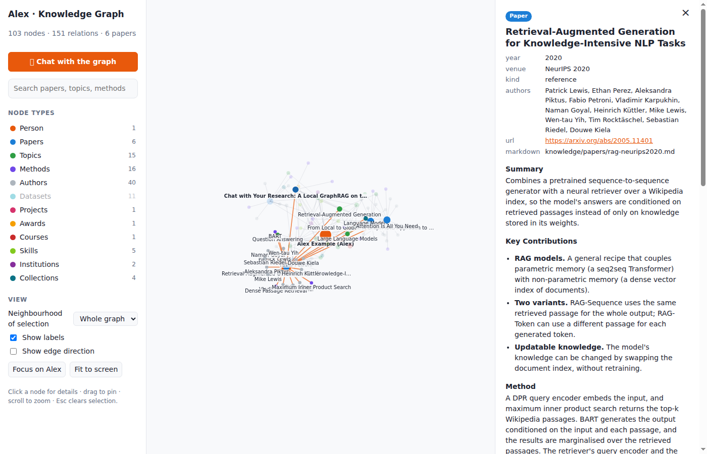

# Knowledge graph example (Tim): a personal research graph with a local LLM chat

A personal research **knowledge graph** that runs entirely on a **Thundercomm RUBIK Pi 3**. You write short markdown notes about yourself and the papers you read. A build script turns them into a graph that you can explore in the browser, and a small LLM running locally in **Ollama** answers questions using only facts retrieved from that graph (GraphRAG-lite). Nothing is sent to the cloud.

```
 knowledge/*.md ──build-graph──▶ graph.json ──▶ browser UI (force-directed graph, search, details)
   profile.md                        │
   taxonomy.md                       ▼
   papers/*.md              Node.js server ──BM25 + 1-hop facts──▶ Ollama (qwen3.5:2b) ──▶ streamed answer
```



The repository ships with a **fictional example person ("Alex Example")** and six papers, so it works straight after you clone it. Replace them with your own data by following [chapter 4](docs/04-customize-your-data.md).

## Tutorial

| # | Chapter | What you get |
|---|---|---|
| 1 | [Prepare the RUBIK Pi 3](docs/01-prepare-rubik-pi.md) | Ubuntu package sources, build tools, Node.js 22 |
| 2 | [Install Ollama and a model](docs/02-install-ollama.md) | `ollama` service + `qwen3.5:2b`, tested with one prompt |
| 3 | [Run the knowledge graph](docs/03-run-the-app.md) | The web UI and chat at `http://<pi-ip>:4173` |
| 4 | [Use your own data](docs/04-customize-your-data.md) | Your profile, topics and papers in the graph |
| 5 | [Keep it running](docs/05-keep-it-running.md) | A systemd service that survives logout and reboot |
| 6 | [How it works](docs/06-how-it-works.md) | The build pipeline, the retrieval, the API, and ideas for extending it |
| 7 | [Troubleshooting](docs/07-troubleshooting.md) | "Failed to fetch", "chat API offline", slow answers, build errors |

## Quick start (if you already have Node.js ≥ 22.18 and Ollama)

```bash
git clone https://github.com/RF-Wireless-FPGA-Design/Qualcomm-RubikPi3.git
cd Qualcomm-RubikPi3/knowledge-graph-example-tim
ollama pull qwen3.5:2b

cd app
npm ci
npm run serve          # builds everything and serves the UI + chat on port 4173
```

Open `http://localhost:4173` on the Pi, or `http://<pi-ip>:4173` from a laptop on the same network (`hostname -I` prints the Pi's IP address).

To set up a fresh board in one go, run `./scripts/setup-rubik.sh`. It performs chapters 1–3 and asks for `sudo` when it needs it.

## Folder layout

```
knowledge-graph-example-tim/
├── README.md                ← you are here
├── docs/                    ← the tutorial chapters
├── knowledge/               ← YOUR DATA (the only folder you need to edit)
│   ├── profile.md           ← you: institutions, interests, skills, projects, awards, courses
│   ├── taxonomy.md          ← topic hierarchy (child: parent)
│   ├── papers/*.md          ← one file per paper (YAML frontmatter + summary sections)
│   ├── papers/INDEX.md      ← generated table of papers
│   ├── templates/           ← blank templates to copy
│   └── export/              ← generated, embedding-ready nodes.jsonl / triples.jsonl
├── app/                     ← the TypeScript application
│   ├── scripts/build-graph.ts   markdown → public/graph.json (+ exports)
│   ├── scripts/draft-paper.ts   PDF → draft paper markdown, written by the local LLM
│   ├── server/server.ts         static files + /api/health + /api/chat (streams from Ollama)
│   ├── server/retrieve.ts       BM25 search over nodes + graph-neighbourhood context
│   ├── src/main.ts              graph UI (force-graph)
│   └── src/chat.ts              chat panel
├── deploy/rubik-kg.service  ← systemd unit (chapter 5)
└── scripts/setup-rubik.sh   ← one-shot setup for chapters 1–3
```

## Tested with

| Component | Version |
|---|---|
| Board | Thundercomm RUBIK Pi 3 (Qualcomm QCS6490, 8 × ARM64 cores, 8 GB RAM, of which 7.1 GB is usable) |
| OS | Ubuntu 24.04.5 LTS (kernel `6.8.0-1084-qcom`) |
| Node.js / npm | 22.23.3 / 10.9.9 |
| Ollama | 0.40.3 (CPU only) |
| Model | `qwen3.5:2b` (2.7 GB). One chat answer took about 100 s on the Pi's CPU (board-measured) |

The app itself is plain Node.js and also runs on any Linux, macOS or Windows machine that has Ollama.
