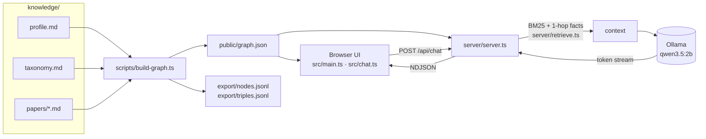

# 6. How it works

## 6.1 Build: markdown → graph (`app/scripts/build-graph.ts`)

1. **Parse** each file's YAML frontmatter with the `yaml` package. The markdown body is split into `## Summary`, `## Key Contributions` and the other sections.
2. **Create nodes** with stable ids `type:slug`, for example `topic:federated-learning` and `paper:rag-neurips2020`. Because the id is derived from the name, the same name used in two files becomes **one** node, and that is how papers get connected.
3. **Create edges** `(source, RELATION, target)`. Duplicates and self-loops are dropped.
4. **Validate.** Any edge that points to a missing id stops the build with a message.
5. **Write embedding text.** Each node gets a `text` field that combines its label, summary, properties, body and every incident edge as an English sentence ("Retrieval-Augmented Generation for … builds on Attention Is All You Need.").
6. **Write outputs:** `public/graph.json` for the UI and the server, the two JSONL exports, and `papers/INDEX.md`.

`graph.json` has the shape `{ generatedAt, owner: {id, name, short, headline, suggestions}, nodes: [...], edges: [...] }`. The types are defined in `app/src/types.ts`.

## 6.2 Retrieval: question → context (`app/server/retrieve.ts`)

This is "GraphRAG-lite". It uses no embedding model, so it runs instantly on the Pi's CPU.

1. **Index.** Each node becomes a BM25 document: its label (counted 3×), its type (2×), summary, body, and the names of its relations. Including the type and relation words is what lets "which **awards** …" or "who **teaches** …" match nodes whose text never uses those words. Tokens are lower-cased, a stop-word list is removed, and plurals are lightly stemmed (awards → award).
2. **Rank.** BM25 (k1 = 1.2, b = 0.75) scores every node against the last **two** user messages, so a follow-up like "what method did it use?" keeps its subject. Collection nodes are down-weighted (×0.3) because they match almost everything.
3. **Expand.** The top 8 nodes are the seeds. If a node is selected in the UI, it is always seed #1. For each seed the server writes a block with its properties, its markdown body (≤ 1,400 characters) and up to 30 incident relations, for example `RAG … —builds on→ Attention Is All You Need`.
4. **Budget.** Blocks are added until the context reaches about 7,000 characters, which keeps the prompt inside the model's 8k-token window together with the chat history.

## 6.3 Generation (`app/server/server.ts`)

The prompt sent to Ollama's `/api/chat` contains:

- a **system message**: "Answer ONLY from the knowledge-graph context …", followed by the owner's brief (affiliations, interests, skills, courses, own papers; this part is always included) and the retrieved context;
- the last 6 chat messages.

The request uses `temperature: 0.2`, `num_ctx: 8192` and `keep_alive: 30m`, and sets `think` from the UI's **Reasoning** checkbox. The server re-emits Ollama's stream as NDJSON events:

| Event | Payload |
|---|---|
| `sources` | the seed nodes, sent first so the UI can highlight them while the answer is being written |
| `thinking` | reasoning tokens (only when Reasoning is on) |
| `token` | answer text |
| `done` | `{tokens, seconds}` |
| `error` | the error message from Ollama or the server |

`GET /api/health` reports the model name, the graph size, and whether Ollama is reachable and has the model. The same server process serves the built UI from `dist/`.

## 6.4 Ideas for extending it (course project suggestions)

- **Vector retrieval.** Embed `export/nodes.jsonl` with `ollama pull nomic-embed-text` (`/api/embed`) and combine cosine similarity with BM25 (hybrid search).
- **Multi-hop answers.** Expand 2 hops from the seeds, or follow only selected relations (`BUILDS_ON` chains).
- **New node types**, e.g. `Venue` or `Lab`: add the type to `NodeType` in `src/types.ts` and a colour in `TYPE_STYLE` in `src/main.ts`, then create the nodes in `build-graph.ts`.
- **Use the NPU.** Ollama runs on the CPU only. Qualcomm's QAIRT/Genie runtime can run LLMs on the Hexagon NPU, so you could replace the `fetch(OLLAMA …)` call with a call to that runtime.
- **Evaluation.** Write 20 questions with known answers about your graph and measure retrieval recall (is the right node among the `sources`?) and answer accuracy.
- **Graph databases.** Load `export/triples.jsonl` into Neo4j and compare Cypher queries with the chat answers.

Next: [7. Troubleshooting →](07-troubleshooting.md)
